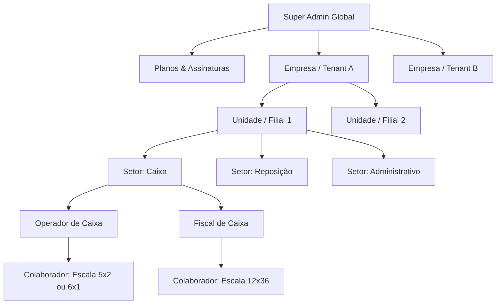
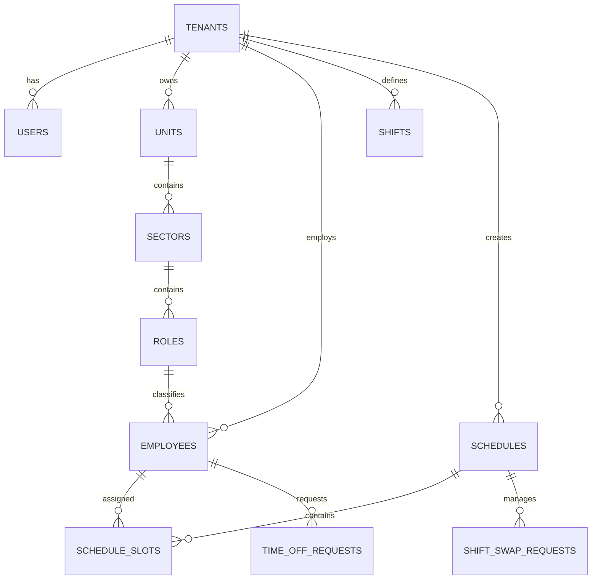

# OrganizaEscala — Documento de Requisitos e Arquitetura do Sistema (PRD)

---

## 1. Visão Geral do Produto

O **OrganizaEscala** é uma plataforma SaaS web responsiva de gestão e geração inteligente de escalas de trabalho voltada para empresas corporativas, comércio varejista e prestadores de serviços, operando com total aderência à legislação trabalhista brasileira (CLT) e convenções sindicais.

O sistema elimina o retrabalho de montagem de planilhas manuais através de um **motor algorítmico de alocação de turnos**, diagnóstico de déficit de quadro de pessoal, grade visual interativa e portal de autoatendimento para colaboradores.

---

## 2. Infraestrutura & Stack Tecnológica

Com base no diagnóstico da hospedagem Linux LiteSpeed cPanel analisada (`infra_hospedagem_web.pdf`):

| Componente | Especificação |
| :--- | :--- |
| **Servidor Web** | LiteSpeed Web Server (LSAPI) em CloudLinux 9 |
| **Linguagem Backend** | **PHP 8.2.34** nativo (OPcache ativado, 4GB Memory Limit, 900s timeout) |
| **Framework Backend** | **Laravel 11** (Arquitetura limpa, alta performance, sem necessidade de daemons externos) |
| **Banco de Dados** | **MySQL 8** (acesso via PDO MySQL nativo do PHP 8.2) |
| **Frontend / Interface** | **Blade Templates + Tailwind CSS + Alpine.js** (responsivo para Desktop e Mobile, leve, rápido) |
| **Multi-Tenancy** | Modelo Single-Database com coluna `company_id` e Global Scopes automáticos no Eloquent |

---

## 3. Hierarquia Organizacional & Multi-Tenancy

### Perfis de Acesso
1. **Super Administrador**: Gerencia empresas assinantes, planos e define o limite de colaboradores gratuitos por empresa.
2. **Gestor / RH da Empresa**: Configura filiais, setores, cargos, jornadas/turnos, políticas de troca, WhatsApp API e gera/ajusta as escalas.
3. **Líder / Encarregado de Setor**: Acompanha a escala do seu setor, faz substituições operacionais e visualiza faltas.
4. **Colaborador**: Visualiza sua escala individual no celular, solicita folgas e propõe trocas de turno. Suporta colaboradores intermitentes vinculados a mais de uma função ou unidade.

---

## 4. Regras Trabalhistas & Motor de Geração de Escala

### 4.1. Regras CLT Nativas
- **Interjornada de 11h**: Intervalo mínimo ininterrupto de 11 horas consecutivas entre duas jornadas diárias.
- **DSR (Descanso Semanal Remunerado) de 24h**: Folga semanal de 24h consecutivas (totalizando 35h de repouso com as 11h de interjornada).
- **Limite de Dias Consecutivos**: Máximo de 6 dias consecutivos trabalhados sem folga.
- **Regras de Domingos**: Pelo menos 1 domingo de folga no mês (ou a cada 2/3 semanas, configurável por setor/cargo conforme convenção coletiva).
- **Escalas Mistas**: Empresas podem operar com colaboradores em 5x2 (padrão recomendado), 6x1 (setores com exceção/permissão), 12x36 (segurança/portaria/saúde) ou personalizadas.

### 4.2. Demandas por Posto & Diagnóstico de Déficit
O gestor define o requisito mínimo por turno/dia da semana (exemplo: sábado à tarde requer 4 caixas e 1 fiscal).
O motor executa o cálculo prévio e emite diagnóstico:
> **Alerta de Déficit de Pessoal**: *"Para o Setor Caixa aos Sábados, faltam 2 colaboradores contratados para manter a cobertura sem violar a interjornada de 11h dos funcionários atuais."*

### 4.3. Modos de Geração
- **Modo Estrito CLT (Padrão)**: O algoritmo não aloca turnos que firam a CLT; deixa o posto vago com badge informativo se faltar pessoal.
- **Modo Cobertura Máxima**: O algoritmo tenta preencher todos os postos de atendimento e marca explicitamente em vermelho os pontos de infração para o gestor ajustar e negociar.

---

## 5. Interface de Visualização & Edição de Escalas

O gestor possui duas visões alternáveis em tempo real:
1. **Visão Colaborador x Dias**:
   - Linhas agrupadas por Unidade/Setor e Colaboradores.
   - Colunas com os dias do período (personalizável: mês completo, quinzena ou período customizado).
   - Células com badges dos turnos, folgas (DSR, folga solicitada, férias).
   - Rodapé com medidor de Cobertura Realizada vs Meta exigida.
2. **Visão Posto/Turno x Dias**:
   - Linhas com os horários de turnos de cada setor.
   - Células indicando quais colaboradores estão escalados naquele posto.
   - Destaque imediato para postos desatendidos.

---

## 6. Fluxos de Trocas de Turnos & Notificações

### 6.1. Política de Trocas Configurável pela Empresa
O gestor escolhe no painel qual das 3 modalidades está ativa na sua empresa:
- **Opção A (Peer-to-Peer com dupla checagem)**: Colaborador A solicita -> Colaborador B aceita -> Sistema valida regras CLT -> Gestor aprova.
- **Opção B (Solicitação Direta ao Gestor)**: Colaborador solicita a troca diretamente ao gestor.
- **Opção C (Exclusivo da Gestão)**: Colaboradores apenas consultam; trocas só são realizadas manualmente pela chefia.

### 6.2. Distribuição & Notificações
- **Portal Mobile do Colaborador**: Acesso com E-mail e Senha (com recuperação por E-mail ou CPF).
- **Mural Impresso (PDF)**: Exportação em PDF com layout oficial para quadro de avisos com cabeçalho da empresa e campo para assinatura dos colaboradores.
- **Integração WhatsApp API Própria**: No painel do gestor, a empresa pode cadastrar sua URL de API e Token (ex.: Evolution API, Z-API) para disparo automático de avisos de escala e lembretes de plantão aos colaboradores.

---

## 7. Planos & Monetização

- **Controle pelo Super Admin**: No dashboard administrativo master, o Super Admin pode parametrizar o limite de colaboradores gratuitos (default: ex. 15 colaboradores) individualmente ou globalmente.
- **Tiers de Assinatura**: Preparado para limites escaláveis (ex: Starter até 20, Pro até 50, Enterprise ilimitado), com arquitetura desacoplada para conexão futura com Asaas ou Mercado Pago.

---

## 8. Estrutura do Banco de Dados (Entidades Principais)

---

## 9. Próximos Passos & Início do Desenvolvimento

1. Configuração do repositório base Laravel 11 estruturado para rodar no LiteSpeed (public_html/symlink).
2. Criação das migrações do banco de dados (Tenants, Users, Units, Sectors, Roles, Employees, Shifts, Schedules, Requirements).
3. Implementação do Motor Algorítmico PHP de alocação de escalas com regras de interjornada, DSR e domingos.
4. Criação dos Dashboards do Gestor (Visão Colaborador x Dias e Posto x Dias) e Portal do Colaborador.
